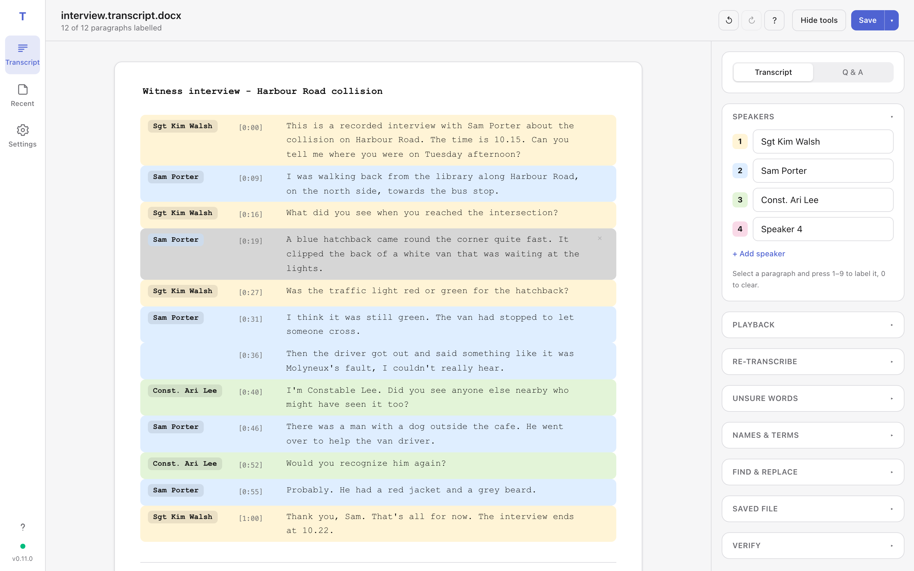
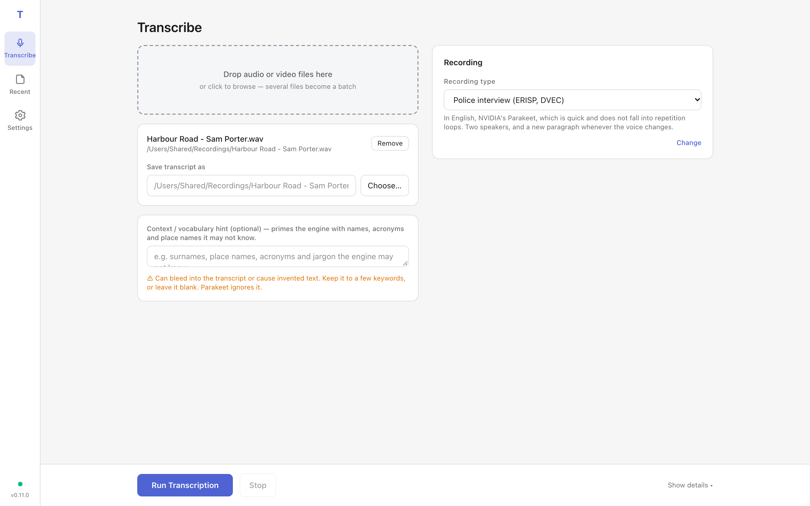
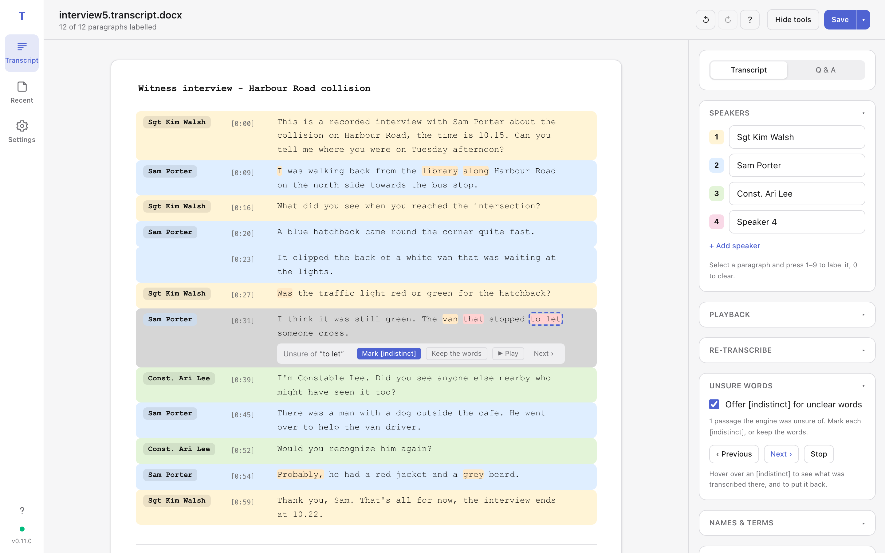
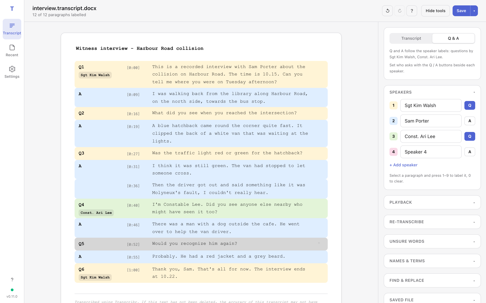

# Transcribr

(c) Fisheggs Pty Ltd, 2026. Version 0.11.0.

**Website and downloads: <https://jamesleaver.github.io/Transcribr/>**

Transcribr turns interviews, hearings and other recordings into
transcripts you can check, label and save as Word, PDF or text, on macOS
and Windows. Speech recognition runs on your computer (faster-whisper,
NVIDIA's Parakeet, or mlx-whisper where installed); the transcript fills
in as the recording is processed, is grouped into paragraphs by speaker,
and opens in a review pane where you label speakers, correct the text
against the audio, switch to a numbered question-and-answer layout, and
decide what to mark `[indistinct]`.

**Everything runs locally — no audio, video or transcripts are uploaded
to the internet.** This may be particularly important for lawyers who
need transcripts of material that it may not be appropriate to upload to
an external website or AI service: material subject to non-publication
or suppression orders, the implied (_Harman_) undertaking, material
produced on subpoena, or anything under a statutory prohibition on
publication.

Transcribr makes machine transcriptions, which can contain mistakes.
Check every transcript against the recording before relying on it.

Questions: [hello@fisheggs.au](mailto:hello@fisheggs.au)



## What this repository contains

Most people never see this — installers are on the
[releases page](https://github.com/jamesleaver/Transcribr/releases/latest).
This is the source they are built from.

```
Transcribr/
├── INSTALL.txt              ← Quick-start instructions
├── README.md                ← This file
├── transcribr/              ← The application itself (backend + API)
│   ├── __main__.py          ←   `python3 -m transcribr` starts here
│   ├── paragraphs.py        ←   segments → paragraphs, and rendering
│   ├── writers.py           ←   .docx / .pdf / .txt output
│   ├── worker.py            ←   the transcription run itself
│   ├── workerproc.py        ←   runs it in a child process, supervised
│   ├── review.py            ←   one open review session
│   ├── server.py            ←   loopback HTTP server, JSON API, SSE
│   └── …                    ←   21 modules; __init__.py lists them all
├── web/                     ← Review interface source (React + TypeScript)
├── webdist/                 ← The built interface, committed and shipped
├── site/                    ← The website (GitHub Pages)
├── docs/licence/EULA.md     ← The end-user licence agreement
├── tests/                   ← Automated test suite
│   ├── test_transcribr.py
│   ├── test_web.py
│   └── run_tests.command    ← Mac users: double-click to run the tests
├── macos/
│   ├── build-pkg.sh         ← Builds the signed, notarised .pkg
│   ├── bootstrap.sh         ← Fetched by the one-line Terminal install
│   ├── install.command      ← The script installer it runs
│   ├── entitlements.plist   ← Hardened-runtime exceptions for signing
│   └── app_template/        ← Launcher, icon and Info.plist for the bundle
├── windows/
│   ├── build-exe.ps1        ← Stages the self-contained tree
│   ├── transcribr.iss       ← Inno Setup script that packs the .exe
│   ├── bootstrap.ps1        ← Fetched by the one-line Terminal install
│   ├── install.ps1          ← The script installer it runs
│   └── install.bat          ← Wrapper that launches install.ps1
└── .github/workflows/       ← Tests, the Windows installer, the website
```

## Requirements

**macOS:**
- macOS 11 (Big Sur) or later
- ~3 GB free disk space (mostly for the Whisper models)

**Windows:**
- Windows 10 (1809+) or Windows 11
- ~3 GB free disk space (mostly for the Whisper models)

## How to install

### macOS — the installer package (recommended)

1. Download the `.pkg` for your Mac from the
   [latest release](https://github.com/jamesleaver/Transcribr/releases/latest)
   — `-arm64` for Apple Silicon, `-x86_64` for Intel. (Apple menu →
   About This Mac, if you're unsure.)
2. Double-click it and follow the prompts.

Signed and notarised by Apple, so it opens with no security warnings.
Self-contained: Python and the transcription engine are inside it, so
nothing else is downloaded and no connection is needed to install.

Two optional engines are left out to keep the download small:
**mlx-whisper**, which runs on Apple Silicon's GPU (~350 MB), and
**openai-whisper**, the reference implementation (~2 GB, PyTorch).
Install either in one click from the **Models** tab. Model weights are
downloaded on first use, as always.

### macOS — Terminal install

Open **Terminal** (cmd+space, type "terminal") and paste:

```bash
curl -fsSL https://raw.githubusercontent.com/jamesleaver/Transcribr/main/macos/bootstrap.sh | bash
```

Unlike the package, this builds a Python environment on your Mac. It
installs Homebrew and Python 3.12 if they are missing, **so it will ask
for your password**, and on Apple Silicon it also installs mlx-whisper —
which makes for a much larger install (~1.4 GB) but gives you GPU
transcription immediately. It needs a working connection throughout.

Most people should use the package. This route exists for unattended or
scripted setups, machines where policy blocks installer packages, and
anyone who simply prefers it.

It will:

- Ask before installing Homebrew (only if missing)
- Install Python 3.12 via Homebrew
- Create a virtual environment at `~/Library/Application Support/Transcribr/`
- Install faster-whisper and sherpa-onnx (speaker detection), plus
  mlx-whisper on Apple Silicon (macOS 13.5+), along with python-docx,
  reportlab, pywebview and bottle — no separate ffmpeg needed
- Create `/Applications/Transcribr.app`

### macOS — after installing

Launch from Spotlight, Launchpad, or the Applications folder.

`Transcribr.app` in `/Applications` is shared by every user account on
the Mac, and each account keeps its own environment under its own
`~/Library/Application Support/Transcribr/`, created automatically on
first launch.

### Windows

1. Download **`Transcribr-<version>-Setup.exe`** from the
   [latest release](https://github.com/jamesleaver/Transcribr/releases/latest).
2. Run it.

> **SmartScreen will warn you**, because the installer is not yet signed
> with a code-signing certificate: click **More info → Run anyway**. A
> certificate is a separate purchase from Apple's, and is on the list.

Launch from your Desktop or Start Menu (search "Transcribr"). As on
macOS, **openai-whisper** is not included (PyTorch, ~2 GB) — add it from
the **Models** tab if you want it.

### Windows — Terminal install

The same alternative as on macOS. In **PowerShell**:

```powershell
irm https://raw.githubusercontent.com/jamesleaver/Transcribr/main/windows/bootstrap.ps1 | iex
```

This fetches the release and runs the PowerShell installer inside it,
which downloads Python 3.12 from python.org and builds a virtual
environment at `%LOCALAPPDATA%\Transcribr\venv` — rather than using the
self-contained runtime the Setup `.exe` carries. It needs a working
connection throughout.

Use it for scripted setups, or where policy blocks running an unsigned
`.exe`. Otherwise the Setup `.exe` above is simpler.

## How to use

### 1. Choose a recording

Drop an audio or video file onto the window, or click the drop zone to
browse. Pick the **recording type** and Transcribr sets the engine, the
number of speakers and how paragraphs break to suit it; **Change** shows
the model, the pause that starts a new paragraph, and the heading, if you
want to adjust them. Drop several files at once to transcribe them as an
unattended batch — each is saved next to its recording, to review later
from **Recent**.



Transcribr reads anything FFmpeg can: the everyday formats (`.mp3`,
`.wav`, `.m4a`, `.mp4`, `.mov`, `.aac`, `.flac`, `.ogg`, `.opus`,
`.webm`) and the ones legal material tends to arrive in — interview
exports (`.wma`, `.wmv`, `.asf`), dictaphone files (`.dss`, `.ds2`),
phone recordings (`.amr`, `.3gp`) and disc rips (`.vob`, `.mpg`).

| Recording type | What it sets |
|---|---|
| **General** | The defaults |
| **Police interview (ERISP, DVEC)** | Parakeet in English, two speakers, a new paragraph when the voice changes |
| **Phone call** | As for an interview; a recording with a channel per speaker is labelled by channel |
| **Hearing or court** | Whisper, speaker count left to you |
| **Meeting or conference** | Whisper, speaker count left to you |
| **Body-worn video** | Whisper, speaker count left to you |
| **Dictation (one speaker)** | One speaker, a longer pause before a new paragraph |

The model choices are **Quick draft** (Parakeet in English, `small`
otherwise; ~500 MB), **Standard** (`large-v3-turbo`, ~1.6 GB,
recommended) and **Maximum accuracy** (`large-v3`, ~3 GB). Each
downloads once, the first time it is used, and can be fetched ahead of
time or removed on the **Models** page in Settings.

The optional **context / vocabulary hint** primes the engine with names
and terms it may not know. Keep it to a few keywords —
*Macklebum, Bloggs, Mount Druitt, AVO, ICAC* — or leave it blank: a
prompt can bleed into the transcript or cause invented text. Parakeet
ignores it.

### 2. Review as it transcribes

Press **Run transcription**. The transcript opens straight away and fills
in as the engine works; everything above the grey tail is ready to
correct. The keys:

| | |
|---|---|
| `↑` `↓` | Previous / next paragraph |
| `1`–`9`, `0` | Label the paragraph with a speaker / clear it |
| `Enter` | Edit the paragraph (`Enter` again to finish, `Esc` to cancel) |
| `Ctrl+Enter` while editing | Split at the cursor |
| `Ctrl+M` while editing, or `M` | Join to the paragraph above |
| `Ctrl+↑` `Ctrl+↓` while editing | Edit the previous / next paragraph |
| Double-click a word | Split the paragraph there |
| `P` / `⌘P` | Play the paragraph / play on from it |
| `N` | Next paragraph that needs attention |
| `U` / `⇧U` | Next / previous unsure passage |
| `⌘Z` / `⌘⇧Z` | Undo / redo |
| `⌘F` | Find |
| `?` | Show all of these |

(`Ctrl` for `⌘` on Windows.) Name the speakers in the **Speakers** card;
the names replace the numbers in the saved document. Click the heading
to change it, and a paragraph's `[MM:SS]` stamp to correct or hide it.
Right-click a paragraph for **Re-transcribe**, edit, join and delete.

The tools panel on the right opens with the layout switch and the
speakers; the other cards fold to their titles: **Playback** (with half
speed, and **Locate audio…** if the recording has moved),
**Re-transcribe**, **Unsure words**, **Names & terms** (correct a
misspelt name everywhere at once), **Find & replace**, **Saved file**
and **Verify**.

Work is saved every few seconds while you review; if the app is closed
unexpectedly, the next launch offers to restore the session.

### 3. Check the doubtful parts

Words the engine was unsure of are shaded. Open **Unsure words** and
press **Start** (or press `U`) to step through the passages it was least
sure of; play each, then **Mark [indistinct]** or **Keep the words**.
Nothing is replaced unless you choose it. An accepted marker remembers
what was transcribed there: hover over it to see the words, and
**Restore** to put them back. The offers can be switched off in the same
card.



If a whole passage has come out wrong — a repeated loop, invented text —
right-click it (or shift-click to select several paragraphs first) and
choose **Re-transcribe**. Only that part of the recording is run again,
by default with a different engine from the one that made the
transcript; the rest of the transcript stays editable meanwhile, and
**Undo** reverses it. Paragraphs that look like a loop or invented text
are marked with an amber stripe.

Stretches of a recording with no sound at all — a microphone switched on
late, a muted line — are marked `[No audio from 00:00 to 04:12]` rather
than filled with invented text.

### 4. Questions and answers

For an interview, switch the layout at the top of the tools panel to
**Q & A**. Questions are numbered and answers marked, the way a record of
interview reads; `[No audio]` lines carry no number. The **Q** / **A**
button beside each speaker says who asks — until you press one, the
askers are suggested from the wording — and when a different person
takes over the questions, that question names them. Save writes the
layout you see, and a Q&A Word document reopens in Q&A mode.



### 5. Save

Under **Saved file**, choose whether to include timestamps, colour each
speaker's paragraphs, and the Word layout:

- **Plain** — a monospaced A4 document with timestamps in the margin;
- **Court** — Times New Roman, double spaced, every line numbered from 1
  on each page, the heading and recording at the head of each page;
- **ERISP** — a record-of-interview heading, 1.5 spaced, numbered lines.

Then press **Save**. The menu beside it saves without speaker labels, as
a new revision of a reopened transcript, or exports a PDF copy. Word is
the default format (`.txt` and `.pdf` are in Settings); a saved `.docx`
or `.txt` can be reopened from **Recent** to carry on reviewing, and a
`.docx` remembers where its recording is.

Once you have checked the transcript against the recording, type your
name under **Verify**. The saved document then says *"This transcript has
been verified by …"*; until then it carries a warning that it may not
have been checked by a person.

### Settings

**Settings** holds the default save format and Word layout, the
language (auto-detect, or set it — and *translate into English* if you
want that), speaker detection, extra files (SRT / VTT subtitles, a TSV
spreadsheet, the engine's raw JSON), the theme, update checks, the
**Models** page, and **Accuracy tuning**, which rarely needs touching:
the engine (**Automatic** picks faster-whisper), beam size, the
thresholds that catch loops and silence, and whether each window is fed
the text before it (off by default — it tends to cause repetition
loops). **Acknowledgements** lists the third-party software and models.

## Running the tests

```bash
python3 -m unittest discover -s tests -v
```

or double-click `tests/run_tests.command` on a Mac (uses the app's
venv, which has the optional dependencies). Tests that need an
optional package or a display skip themselves; the suite never touches
your real settings.

## Updating

Transcribr asks GitHub once per launch whether a newer release exists.
When there is one, a strip appears across the top of the window naming
the new version, with **What's new** for that release's notes:

- **Update now** downloads the installer that suits your machine — the
  `.pkg` on macOS, the Setup `.exe` on Windows — checks it against the
  SHA-256 checksum GitHub publishes for the file, and opens it. Follow
  it through, then restart Transcribr.
- **Not now** hides the strip until the next launch.

The check is a plain, unauthenticated `GET` of the public releases API.
No transcripts, recordings, file names or usage data leave your
computer. If you would rather Transcribr never touched the network on
its own, turn off **Settings -> Updates -> Check for new versions on
launch**; **Check now** on that page still works on demand.

## Reinstalling and upgrading

Normally you don't need to: Transcribr checks for new versions on
launch and can install them itself (see [Updating](#updating) above).

To do it by hand, just install again over the top — every route is safe
to repeat:

- **The package** — download the new `.pkg` and run it. It replaces the
  application in place; your settings, recent files and any extra
  engines are untouched.
- **The Terminal install** — re-run the one-liner for your platform. It
  skips what is already present, offers to rebuild the environment from
  scratch (say no for a quick refresh, yes if something is genuinely
  broken), and always rebuilds the launcher and shortcuts.

Switching between the two is fine in either direction. They share the
same settings and per-user folder, so nothing is lost.

## Where things go

This differs slightly depending on how you installed, because the
package carries its own Python while the Terminal install builds one.

### macOS

| What | Where |
|---|---|
| The application | `/Applications/Transcribr.app` |
| Settings / recent / autosave | `~/Library/Application Support/Transcribr/*.json` |
| Per-user environment (extra engines) | `~/Library/Application Support/Transcribr/venv/` |
| Speaker-detection models | `~/Library/Application Support/Transcribr/models/` |
| Cached audio prepared for playback | `~/Library/Application Support/Transcribr/audio_cache/` |
| Launch logs | `~/Library/Logs/Transcribr/launch.log` |
| Whisper model cache | `~/.cache/huggingface/hub/` |

With the **package**, Python, the app script and the web interface all
live inside `Transcribr.app` itself, and the per-user environment is
created on first launch purely to hold any engines you add later. With
the **Terminal install**, `transcribr/`, `webdist/` and the full
environment sit in `~/Library/Application Support/Transcribr/` instead,
and the app bundle is only a launcher.

### Windows

| What | Where |
|---|---|
| The application (Setup `.exe`) | `%LOCALAPPDATA%\Programs\Transcribr\` |
| The application (Terminal install) | `%LOCALAPPDATA%\Transcribr\` |
| Settings / recent / autosave | `%APPDATA%\Transcribr\*.json` |
| Speaker-detection models | `%APPDATA%\Transcribr\models\` |
| Cached audio prepared for playback | `%APPDATA%\Transcribr\audio_cache\` |
| Desktop shortcut | `%USERPROFILE%\Desktop\Transcribr.lnk` |
| Start Menu shortcut | `%APPDATA%\Microsoft\Windows\Start Menu\Programs\Transcribr.lnk` |
| Whisper model cache | `%USERPROFILE%\.cache\huggingface\hub\` |

Nothing is installed outside your own user account on either platform,
which is why neither installer needs an administrator password.

## Uninstalling

Transcribr has no uninstaller; it is all files in your own folders.

### macOS

```bash
rm -rf "/Applications/Transcribr.app"
rm -rf "$HOME/Library/Application Support/Transcribr"
rm -rf "$HOME/Library/Logs/Transcribr"
```

That removes the app, your settings and any engines you added. The
Whisper model weights are cached separately and are worth keeping if you
might reinstall — they are several gigabytes and are re-downloaded on
demand:

```bash
rm -rf "$HOME/.cache/huggingface/hub"      # optional
```

### Windows

The Setup `.exe` registers a normal uninstaller: **Settings → Apps →
Installed apps → Transcribr → Uninstall**. That leaves your settings
behind deliberately; remove them too with:

```powershell
Remove-Item -Recurse -Force "$env:APPDATA\Transcribr"
```

For a Terminal install, or to clear everything by hand:

```powershell
Remove-Item -Recurse -Force "$env:LOCALAPPDATA\Transcribr"
Remove-Item -Recurse -Force "$env:LOCALAPPDATA\Programs\Transcribr"
Remove-Item -Recurse -Force "$env:APPDATA\Transcribr"
Remove-Item -Force "$env:USERPROFILE\Desktop\Transcribr.lnk"
Remove-Item -Force "$env:APPDATA\Microsoft\Windows\Start Menu\Programs\Transcribr.lnk"
Remove-Item -Recurse -Force "$env:USERPROFILE\.cache\huggingface\hub"   # optional
```

## Troubleshooting

**macOS blocks the installer ("unidentified developer", "not opened").**
This should no longer happen: the `.pkg` on the releases page is signed
with an Apple Developer ID and notarised by Apple, and the Terminal
install is never quarantined because `curl` sets no such flag.

If you hit it, you are running something older, or a file that came
down through a browser and was quarantined. Either install with a
current `.pkg`, or clear the flag by hand:

```bash
xattr -dr com.apple.quarantine ~/Downloads/Transcribr-Installer
```

To allow a blocked file instead: **System Settings → Privacy & Security**,
scroll to the bottom, **Open Anyway**. (Right-click → Open no longer
works — Apple removed it in macOS 15 Sequoia.)

`/Applications/Transcribr.app` is never affected by this once installed.

If the app does not launch:

1. **Check the log** at the path shown in the table above. The last
   few lines usually show the cause.
2. **Re-run the installer.** Eight times out of ten, this fixes it.
3. **Test the GUI directly from Terminal / PowerShell** to see live
   errors:

   macOS:
   ```bash
   cd "$HOME/Library/Application Support/Transcribr"
   source venv/bin/activate
   python -m transcribr
   ```

   Windows (PowerShell):
   ```powershell
   cd "$env:LOCALAPPDATA\Transcribr"
   & ".\venv\Scripts\python.exe" -m transcribr
   ```

4. **If the new (web) interface's window won't open**, run it without
   a window and use your browser instead — from the same venv python:

   ```bash
   python -m transcribr --serve
   ```

   then open the printed `http://127.0.0.1:…` URL. That URL only works
   on your own machine.

## Development

The web interface's source lives in `web/` (React + TypeScript,
built with Vite). Node.js (≥ 20) is needed **only for development** —
end users receive the pre-built files in `webdist/`, which are
committed to the repository and must be rebuilt and committed after
changing anything in `web/`:

```bash
cd web
npm install
npm run build     # type-checks, then writes ../webdist/
```

For live-reload development: `python3 -m transcribr --serve` in one
terminal (port 8737, token `dev`) and `npm run dev` in another, then
open the Vite URL. If the repository lives in Dropbox, mark
`web/node_modules` as ignored so it doesn't sync:
`xattr -w com.dropbox.ignored 1 web/node_modules` (macOS).

## What this does NOT install

The Whisper model weights themselves. The first time you run a
particular model from the GUI, the engine downloads it (~500 MB for the
Quick draft tier, ~1.6 GB for Standard, ~3 GB for Maximum accuracy) and
caches it locally; the first use of **Detect speakers automatically**
likewise downloads its two helper models (~33 MB total). Subsequent
runs use the cached versions. You can also pre-download or remove
Whisper models from the **Models** tab.

The reference **openai-whisper** engine (and its ~2 GB PyTorch
dependency) is also not installed by default — add it from the
**Models** tab if you want it.

## Licence

Transcribr is made by **Fisheggs Pty Ltd**. Using it — including for
work — is covered by the **Transcribr End User Licence Agreement**
(`docs/licence/EULA.md`), which the installers show. It is free of
charge.

The source code is available under the **PolyForm Strict License
1.0.0** (`LICENSE`): you may read it and use it for noncommercial
purposes, but not change or redistribute it. Versions up to and
including 0.10.0 were released under the GNU AGPL 3.0
(`LICENSE-AGPL-3.0`), and copies of those remain under it.

Third-party software and models keep their own licences; each build
writes `THIRD-PARTY-NOTICES.txt` from what it actually contains, and the
app shows them under Settings → Acknowledgements.

Questions: hello@fisheggs.au.
